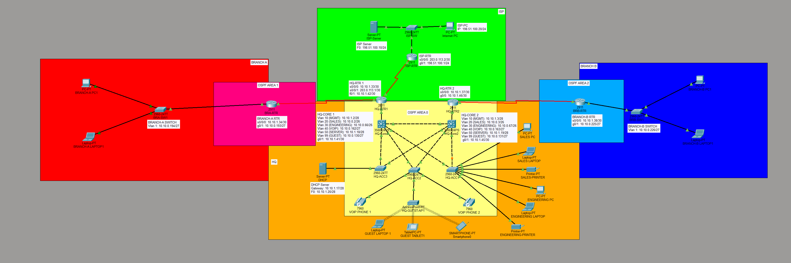

# Enterprise Multi-Site Network in Cisco Packet Tracer

A three-site enterprise network (headquarters and two branch offices) with a simulated ISP, built and verified in Cisco Packet Tracer. The design covers VLAN segmentation, Partial Layer 3 redundancy, multi-area OSPF, serial WAN links with PPP and CHAP, ACL-based security, NAT, eBGP, a wireless guest network and a voice VLAN with IP phones.



## Skills demonstrated

- VLANs, 802.1Q trunking and inter-VLAN routing on Layer 3 core switches
- Gateway redundancy with HSRP and loop prevention with STP, PortFast and BPDU Guard
- VLSM address planning for 12 subnets inside one address block
- Multi-area OSPF with two Area Border Routers and default route origination
- Serial WAN links with PPP and CHAP authentication
- Centralized DHCP with relay agents across three sites
- Extended ACLs for guest isolation, departmental segmentation and management protection
- PAT and static NAT at the internet edge
- eBGP peering with a simulated ISP
- WPA2 wireless guest network mapped to a dedicated VLAN
- Cisco IP phones placed in a dedicated VoIP VLAN with its own subnet and DHCP pool
- Device hardening with SSH-only access, secret passwords and port security

## Design summary

| Site | Role | OSPF area | Devices |
|---|---|---|---|
| HQ | Core, distribution, servers, internet edge | 0 | 2 routers, 2 Layer 3 switches, 3 access switches, 1 server, 1 access point, 2 IP phones |
| Branch A | Remote office | 1 | 1 router, 1 switch |
| Branch B | Remote office | 2 | 1 router, 1 switch |
| ISP | Simulated internet provider | n/a (eBGP) | 1 router, 1 switch, 1 server, 1 PC |

HQ-RTR1 and HQ-RTR2 are the Area Border Routers for Branch A and Branch B.

## Addressing plan (VLSM)

Base block: `10.10.0.0/16`. Subnets were sorted from largest to smallest and allocated sequentially.

| # | Segment | Hosts needed | Prefix | Subnet mask | Network address | Usable range | Broadcast |
|---|---|---|---|---|---|---|---|
| 1 | Sales (VLAN 20) | 50 | /26 | 255.255.255.192 | 10.10.0.0 | 10.10.0.1 to 10.10.0.62 | 10.10.0.63 |
| 2 | Engineering (VLAN 30) | 50 | /26 | 255.255.255.192 | 10.10.0.64 | 10.10.0.65 to 10.10.0.126 | 10.10.0.127 |
| 3 | Guest (VLAN 99) | 30 | /27 | 255.255.255.224 | 10.10.0.128 | 10.10.0.129 to 10.10.0.158 | 10.10.0.159 |
| 4 | VoIP (VLAN 40) | 20 | /27 | 255.255.255.224 | 10.10.0.160 | 10.10.0.161 to 10.10.0.190 | 10.10.0.191 |
| 5 | Branch A LAN | 20 | /27 | 255.255.255.224 | 10.10.0.192 | 10.10.0.193 to 10.10.0.222 | 10.10.0.223 |
| 6 | Branch B LAN | 20 | /27 | 255.255.255.224 | 10.10.0.224 | 10.10.0.225 to 10.10.0.254 | 10.10.0.255 |
| 7 | Management (VLAN 10) | 10 | /28 | 255.255.255.240 | 10.10.1.0 | 10.10.1.1 to 10.10.1.14 | 10.10.1.15 |
| 8 | Servers (VLAN 50) | 10 | /28 | 255.255.255.240 | 10.10.1.16 | 10.10.1.17 to 10.10.1.30 | 10.10.1.31 |
| 9 | WAN HQ-RTR1 to BRA-RTR | 2 | /30 | 255.255.255.252 | 10.10.1.32 | 10.10.1.33 to 10.10.1.34 | 10.10.1.35 |
| 10 | WAN HQ-RTR2 to BRB-RTR | 2 | /30 | 255.255.255.252 | 10.10.1.36 | 10.10.1.37 to 10.10.1.38 | 10.10.1.39 |
| 11 | HQ-CORE1 to HQ-RTR1 | 2 | /30 | 255.255.255.252 | 10.10.1.40 | 10.10.1.41 to 10.10.1.42 | 10.10.1.43 |
| 12 | HQ-CORE2 to HQ-RTR2 | 2 | /30 | 255.255.255.252 | 10.10.1.44 | 10.10.1.45 to 10.10.1.46 | 10.10.1.47 |

Internet edge addressing (documentation ranges used as stand-in public addresses):

| Segment | Subnet | Notes |
|---|---|---|
| HQ-RTR1 to ISP-RTR | 203.0.113.0/30 | HQ-RTR1 .1 and ISP-RTR .2 |
| Public block | 203.0.113.8/29 | 203.0.113.10 is statically NATed to the HQ server |
| ISP internet LAN | 198.51.100.0/24 | ISP-RTR .1, web server .10 and PC .20 |

### HQ gateways (HSRP)

| VLAN | Name | Virtual gateway | HQ-CORE1 (active) | HQ-CORE2 (standby) |
|---|---|---|---|---|
| 10 | Management | 10.10.1.1 | 10.10.1.2 | 10.10.1.3 |
| 20 | Sales | 10.10.0.1 | 10.10.0.2 | 10.10.0.3 |
| 30 | Engineering | 10.10.0.65 | 10.10.0.66 | 10.10.0.67 |
| 40 | VoIP | 10.10.0.161 | 10.10.0.162 | 10.10.0.163 |
| 50 | Servers | 10.10.1.17 | 10.10.1.18 | 10.10.1.19 |
| 99 | Guest | 10.10.0.129 | 10.10.0.130 | 10.10.0.131 |

HQ-CORE1 runs priority 110 with preempt and HQ-CORE2 runs priority 90.

### DHCP

A single DHCP server at HQ (10.10.1.20) serves every site. The cores and both branch routers relay requests with `ip helper-address`.

| Pool | Gateway | First lease | Max users |
|---|---|---|---|
| MGMT | 10.10.1.1 | 10.10.1.4 | 11 |
| SALES | 10.10.0.1 | 10.10.0.4 | 59 |
| ENGINEERING | 10.10.0.65 | 10.10.0.68 | 59 |
| VOIP | 10.10.0.161 | 10.10.0.164 | 27 |
| GUEST | 10.10.0.129 | 10.10.0.132 | 27 |
| BRANCH-A | 10.10.0.193 | 10.10.0.195 | 28 |
| BRANCH-B | 10.10.0.225 | 10.10.0.227 | 28 |

## Routing design

**OSPF (process 1)**

| Router | Router ID | Areas |
|---|---|---|
| HQ-CORE1 | 1.1.1.1 | 0 |
| HQ-CORE2 | 2.2.2.2 | 0 |
| HQ-RTR1 | 3.3.3.3 | 0 and 1 (ABR) |
| HQ-RTR2 | 4.4.4.4 | 0 and 2 (ABR) |
| BRA-RTR | 5.5.5.5 | 1 |
| BRB-RTR | 6.6.6.6 | 2 |

User-facing interfaces are passive. The two core switches form their adjacency over the VLAN 10 interfaces because the link between them is a Layer 2 trunk.

**eBGP**

HQ-RTR1 (AS 65001) peers with ISP-RTR (AS 65002). HQ-RTR1 advertises the public block `203.0.113.8/29` and learns a default route plus the ISP LAN. The default route is then passed into OSPF with `default-information originate`, so every site learns its internet path through one mechanism.

## Switching and redundancy

- Six VLANs (10, 20, 30, 40, 50 and 99) trunked across the HQ switches
- Every access switch is dual-homed to both core switches, with STP blocking the redundant path
- HSRP on each VLAN gives hosts a gateway that survives the loss of one core
- Access ports use PortFast and BPDU Guard. PC ports also use port security, while phone ports skip it because an IP phone can have a PC connected behind it

## WAN links

Both branch links use serial connections with PPP encapsulation and CHAP authentication. The ISP link uses a serial connection with the default HDLC encapsulation. HQ-RTR1 and HQ-RTR2 supply the clock to the branch links and ISP-RTR supplies it to the ISP link.

## Security

- SSH-only remote access with local accounts, and `enable secret` on every device
- Extended ACLs applied inbound on the HQ VLAN interfaces of both cores:
  - `GUEST-IN` allows DHCP and DNS to the HQ server only and blocks all internal subnets
  - `SALES-IN` and `ENG-IN` keep Sales and Engineering separate and block both from the Management VLAN
- NAT hides internal addressing from the ISP
- The wireless guest network uses WPA2-PSK and lands in the guest VLAN, so it inherits the guest ACL

## Internet edge and wireless

- **PAT** on HQ-RTR1 lets all internal hosts share one public address
- **Static NAT** maps the HQ web server (10.10.1.20) to 203.0.113.10 so it can be reached from the ISP side
- **Wireless**: an access point on an HQ access switch broadcasts the `Guest-WiFi` SSID into VLAN 99. Wireless guests receive DHCP leases from the guest pool and can reach the internet but no internal resources.

## VoIP

Two Cisco 7960 IP phones connect to HQ-ACC2 and sit in the VoIP VLAN (VLAN 40, `10.10.0.160/27`). Keeping voice in its own VLAN gives it a separate broadcast domain and subnet from the data VLANs.

- The phone ports on HQ-ACC2 are access ports in VLAN 40 with PortFast and BPDU Guard
- The phones receive their addresses from the `VOIP` pool on the HQ DHCP server through the relay on both HQ cores
- The phone default gateway is the HSRP virtual address `10.10.0.161`, so it follows the gateway if one core fails

## Validation

Replace each placeholder with your own screenshot and delete any row for a test you did not run.

| Test | Command or action | Evidence |
|---|---|---|
| Trunks and VLANs | `show vlan brief`, `show interfaces trunk` | `screenshots/01-vlans-trunks.png` |
| STP blocking redundant uplink | `show spanning-tree vlan 20` | `screenshots/02-stp.png` |
| HSRP active and standby roles | `show standby brief` on both cores | `screenshots/03-hsrp.png` |
| DHCP lease at a branch | `ipconfig /all` on a branch PC | `screenshots/04-dhcp-branch.png` |
| PPP and CHAP up on a WAN link | `show interfaces serial0/0/0` showing LCP Open | `screenshots/05-ppp-chap.png` |
| OSPF neighbors and ABR role | `show ip ospf neighbor`, `show ip ospf` | `screenshots/06-ospf-abr.png` |
| Inter-area routes | `show ip route ospf` on a branch router | `screenshots/07-ospf-inter-area.png` |
| ACL enforcement | `show access-lists` with match counters | `screenshots/08-acl-counters.png` |
| NAT translations | `show ip nat translations` | `screenshots/09-nat.png` |
| BGP session and routes | `show ip bgp summary`, `show ip bgp` | `screenshots/10-bgp.png` |
| Branch to branch path | `tracert` between branch PCs | `screenshots/11-tracert.png` |
| Wireless guest | `ipconfig /all` on the wireless client | `screenshots/12-wireless.png` |
| IP phones in the VoIP VLAN | Phone IP configuration showing a lease from the VOIP pool | `screenshots/13-voip-phones.png` |
| Call between the two phones | Dial one phone from the other | `screenshots/14-voip-call.png` |

## Known limitations and future work

- **Single-homed WAN routers**: HQ-RTR1 and HQ-RTR2 each connect to only one core switch, so losing a core also removes that router's path. Cross-links from each router to the opposite core would close the gap.
- **Single internet edge**: one router and one ISP link. A second edge router or a second provider would remove the single point of failure.
- **Packet Tracer BGP limits**: neighbor passwords and `default-originate` are not supported in the simulator, so the ISP advertises its default route through a Null0 route and a `network` statement. On production IOS, MD5 neighbor authentication and `default-originate` would be used.
- **Lab credentials**: all passwords in the configuration files are lab-only. A production network would use centralized AAA and unique credentials.
- **Further hardening**: DHCP snooping, dynamic ARP inspection, an inbound ACL on the internet-facing interface and route summarization at the ABRs.

## Repository contents

```
.
├── README.md
├── enterprise-network.pkt      Packet Tracer project file
├── diagrams/
│   └── topology.png
├── configs/                    One running-config per device
└── screenshots/                Verification evidence referenced above
```

## Author

Bongani Fuzwayo

[LinkedIn](https://www.linkedin.com/in/bongani-fuzwayo-a04413163) | [GitHub](https://github.com/Bhekstar007)
